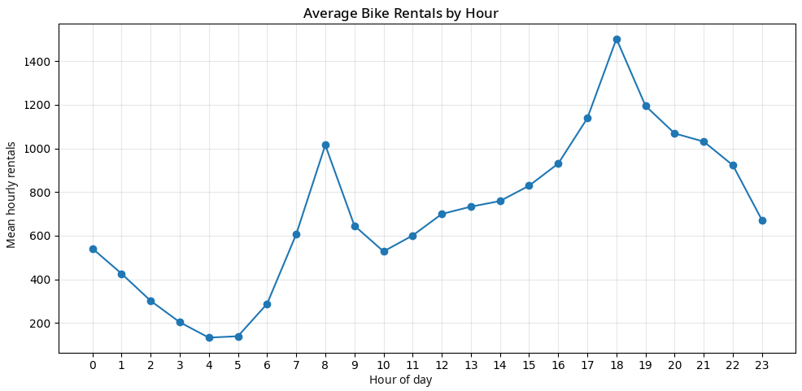
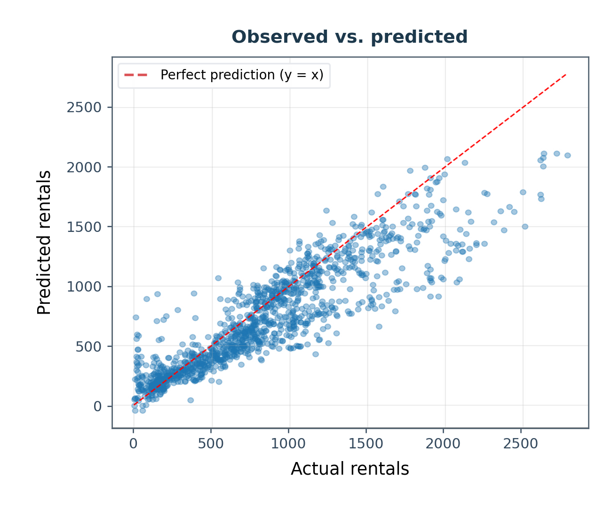
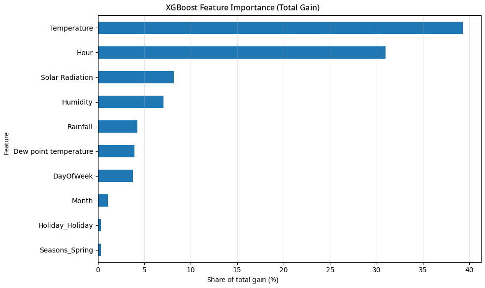

# Forecasting Hourly Bike Rentals with XGBoost

**Applied machine learning project by Ahmet Genç**  
**Dataset:** Seoul Bike Sharing Demand (UCI Machine Learning Repository)  
**Methods:** Python, XGBoost regression, chronological validation, feature engineering, error diagnostics

This project predicts **observed hourly bicycle rentals** in Seoul from meteorological and calendar-related variables. The model estimates recorded rentals while the bike-sharing service is operating; it is not a measure of total or unmet travel demand.

[**Full technical report (PDF)**](Seoul_Bike_Rental_Forecasting_XGBoost_Ahmet_Genc_EN.pdf) · [**Project notebook (Google Colab)**](https://colab.research.google.com/drive/1p9h40Irqsac55hXPZAj7qMtsKABe4KAg?usp=sharing) · [**Dataset (UCI)**](https://doi.org/10.24432/C5F62R)

## Results at a glance

| Held-out test metric | Result |
| --- | ---: |
| Mean Absolute Error (MAE) | **188.83** rentals |
| Root Mean Squared Error (RMSE) | **274.13** rentals |
| Coefficient of determination (R²) | **0.7531** |
| Test observations | **1,265** hourly records |

The selected XGBoost model was refitted on **7,200 training + validation observations** before final evaluation. The test set was held out chronologically and was not used to select hyperparameters.

## Dataset and modeling pipeline

1. **Data audit:** 8,760 hourly rows spanning December 1, 2017 through November 30, 2018. No missing records or duplicate date–hour entries were reported in the analysis.
2. **Operating-hours filtering:** Removed 295 records from periods when the rental system was not functioning; all 295 had zero rentals. This left **8,465 observations** for modeling.
3. **Outlier policy:** An interquartile-range rule identified 152 high observations (about 1.8%); they were retained as potentially valid demand peaks.
4. **Feature engineering:** Derived `Month`, `DayOfWeek`, and `IsWeekend`. Applied one-hot encoding to `Seasons` and `Holiday`; excluded the constant `Functioning Day` and raw `Date` columns. The model used **18 numerical features**, without feature scaling.
5. **Time-aware split:** Kept observations from the same calendar date in the same train, validation, or test subset.
6. **Model selection:** Compared four XGBoost configurations based on **validation RMSE**; candidate A was selected and retrained on the combined training and validation data.

### Chronological split

| Set | Hourly observations | Coverage |
| --- | ---: | --- |
| Train | 5,928 | Dec 1, 2017 – Aug 6, 2018 |
| Validation | 1,272 | Aug 7, 2018 – Oct 3, 2018 |
| Test | 1,265 | Oct 5, 2018 – Nov 30, 2018 |

### Model selection

All candidates used the `reg:squarederror` objective.

| Candidate | Trees | Maximum depth | Learning rate | Validation RMSE |
| --- | ---: | ---: | ---: | ---: |
| **A – Baseline (selected)** | **300** | **4** | **0.10** | **252.93** |
| C – Lower learning rate | 500 | 4 | 0.05 | 260.67 |
| B – Shallower trees | 300 | 3 | 0.10 | 269.80 |
| D – Shallow + slower | 500 | 3 | 0.05 | 270.01 |

## Exploratory analysis

The original dataset shows commute-period peaks near **08:00** (~1,020 rentals per hour on average) and **18:00** (~1,500 rentals). Rental counts generally rise with temperature, but the relationship is nonlinear. Summer has the highest average rentals per hour (**1,034.07**); winter the lowest (**225.54**). These are **observational associations**, not causal conclusions.

## Error diagnostics and interpretation

- **Systematic underprediction:** With residual defined as actual minus predicted, the average test residual was **+114.43 rentals**. The residual standard deviation was **249.11**, and the largest absolute test error was **1,044.29**.
- **Peak-hour weakness:** MAE was highest at **18:00 (562.82)** and **08:00 (533.77)**. The corresponding mean residuals were **+542.39** and **+457.81**.
- **Feature importance:** Temperature (**39.29%**) and hour (**30.95%**) collectively represented **70.24% of total gain**. Gain-based importance describes the fitted model; it does not establish causality.

## Limitations and next steps

The held-out test period includes **autumn only**, so the reported R² should not be generalized directly to other seasons or years. The project also uses only **one year** of observations and shows substantial underprediction during peak rental hours.

Possible extensions include multi-year data, rolling-origin backtesting, specialized peak-hour modeling, and evaluating predictors that would genuinely be available when making future forecasts (especially weather information).

## Data credit

UCI Machine Learning Repository (2020). *Seoul Bike Sharing Demand*. https://doi.org/10.24432/C5F62R (CC BY 4.0). Figures and numerical results are carried over from the original project report and notebook outputs.

**Reproducibility note:** The English report and this README translate and present the documented analysis; they do not claim an independent rerun or audit of the Colab notebook.
